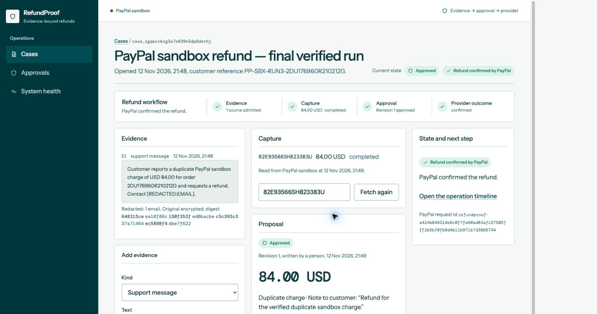
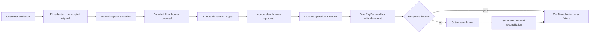
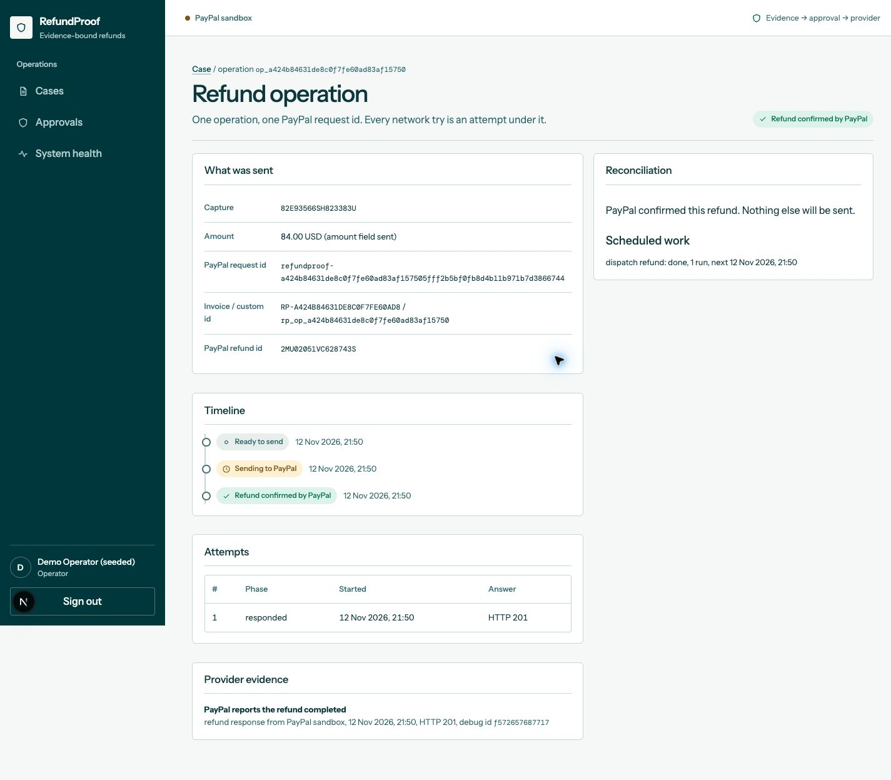

# RefundProof

> Evidence-bound, exactly approved PayPal refunds that survive lost responses.

RefundProof turns a customer refund from a mutable support action into a durable operation with a proof trail. It
redacts customer evidence, reads the real PayPal sandbox capture, creates a bounded refund proposal, binds human
approval to one exact revision digest, sends one idempotent PayPal refund request, and reconciles an unknown network
outcome without blindly sending money again.



## The problem

A refund workflow normally spans a support message, a payment lookup, an AI or human decision, an approval, and a
provider API call. Each step can change independently. The dangerous failure is not simply “the API returned an
error”; it is a timeout after PayPal accepted the refund. Retrying that request without durable identity can create a
second financial effect.

RefundProof makes four facts explicit and durable:

1. **What evidence justified the refund?** Customer text is redacted before proposal generation and the original is
   encrypted at rest.
2. **What exactly was approved?** The amount, currency, reason, capture, evidence digests, and policy are sealed into
   one immutable revision digest.
3. **What exactly was sent?** One operation owns one deterministic PayPal request ID and an append-only attempt log.
4. **What happened after a lost response?** RefundProof records the outcome as unknown and reconciles with PayPal. It
   never treats silence as permission to send again.

## Product flow



The UI has separate operator and approver roles, a case workspace, an exact approval record, an operation timeline,
provider evidence, and system-health reporting. The normal path is usable end to end; it is not a static demo.

## Verified PayPal sandbox run

On 12 November 2026, the normal UI path completed a real PayPal sandbox refund:

| Evidence          | Verified value                                                                 |
| ----------------- | ------------------------------------------------------------------------------ |
| Capture           | `82E93566SH823383U`                                                            |
| Approved amount   | `84.00 USD`                                                                    |
| Operation         | `op_a424b84631de8c0f7fe60ad83af15750`                                          |
| PayPal request ID | `refundproof-a424b84631de8c0f7fe60ad83af157505fff2b5bf0fb8d4b11b971b7d3866744` |
| PayPal refund ID  | `2MU02051VC628743S`                                                            |
| Provider result   | HTTP `201`, PayPal status `COMPLETED`                                          |
| Dispatch attempts | `1`                                                                            |



## How AI is used

The proposal module receives only the redacted evidence, the stored PayPal capture snapshot, and a constrained output
schema. Its output is untrusted: RefundProof validates money precision, citations, reason codes, source digests, and
the exact capture before a person can request approval. AI never approves or executes a refund.

Three provider modes are explicit:

- `anthropic`: calls the Anthropic SDK when the operator supplies its server-side credential.
- `local-fixture`: a labelled deterministic development provider used for the recorded sandbox journey.
- `none`: disables model drafting and keeps the manual proposal path available.

The recorded submission journey did **not** claim an external model call; it used the labelled local fixture while the
real PayPal sandbox integration, approval, durable execution, and reconciliation paths were live.

## Architecture

| Layer         | Implementation                                                                        |
| ------------- | ------------------------------------------------------------------------------------- |
| Console       | Next.js 16, React 19, server routes, responsive operator UI                           |
| Domain kernel | TypeScript money, canonical JSON, digests, state machines, bound IDs                  |
| Persistence   | PostgreSQL 17, forward migrations, tenant-scoped records, append-only ledgers         |
| Security      | role separation, CSRF/session checks, encrypted evidence, redaction, rate limiting    |
| AI boundary   | schema-constrained proposal adapter with citation and source verification             |
| Payments      | PayPal REST sandbox capture read, refund dispatch, idempotency header, reconciliation |
| Durability    | transactional outbox, leased worker jobs, fenced attempts, restart recovery           |

The PayPal adapter refuses live PayPal hosts. Missing sandbox credentials fail closed. A contract-stub capture can
never be refunded through the PayPal adapter because the source is part of the bound operation.

## Run locally

Requirements: Node.js 22+, pnpm 11, and PostgreSQL 17.

```bash
pnpm install --frozen-lockfile
pnpm setup:env
createdb refundproof
pnpm db:migrate
pnpm seed
```

`pnpm seed` creates one clearly labelled development tenant with operator, approver, and admin accounts. Generated
credentials are written with mode `0600` to the gitignored `.local/seed-accounts.json`; they are never printed.

Start the console and the durable worker in separate terminals:

```bash
pnpm dev
```

```bash
pnpm worker
```

Open [http://localhost:3000](http://localhost:3000). See [docs/SETUP.md](docs/SETUP.md) for the full provider matrix
and normal product journey.

### Enable the real PayPal sandbox path

Set these values in the gitignored `.env.local`:

```dotenv
REFUNDPROOF_CAPTURE_SOURCE=paypal-sandbox
PAYPAL_ENV=sandbox
PAYPAL_CLIENT_ID=<sandbox-client-id>
PAYPAL_CLIENT_SECRET=<sandbox-client-secret>
```

Live PayPal is intentionally refused. Never commit provider credentials.

## Verification

```bash
pnpm verify
```

The verification command runs formatting, lint, TypeScript, unit, integration, restart-recovery, production-build,
served-product, secret-scan, build-pack, and dependency-audit gates. The latest exact results and the distinction
between local checks, provider proof, hosting, and submission are recorded in
[docs/BUILD-STATUS.md](docs/BUILD-STATUS.md).

## Security and failure model

- Money is represented as integer minor units and checked against capture bounds.
- Approval is content-addressed; editing the proposal creates a new revision that needs a new approval.
- The proposer cannot approve their own revision.
- The operation ID, invoice/custom IDs, request ID, and outbound body are derived and compared canonically.
- Every dispatch attempt is durable. Unknown outcomes are reconciled before any further action.
- Customer evidence is encrypted at rest; only a redacted copy reaches the proposal boundary.
- Logs and public screenshots omit provider secrets and the original customer contact value.

## Current scope

- PayPal **sandbox** only; live refunds are deliberately unsupported.
- PostgreSQL and a separate worker process are required.
- The public submission uses reproducible local setup rather than pretending a serverless-only deployment can run the
  worker safely.
- Market validation is not claimed. This repository demonstrates the product and its failure-safe mechanism.

## Documentation

- [Local setup and provider modes](docs/SETUP.md)
- [Current implementation and verification status](docs/BUILD-STATUS.md)
- [Submission copy and evidence checklist](docs/SUBMISSION.md)
- [Product and technical build pack](docs/build-pack/START-HERE.md)
- [PayPal execution decision record](docs/decisions/0007-paypal-execution.md)

## License

[MIT](LICENSE)
